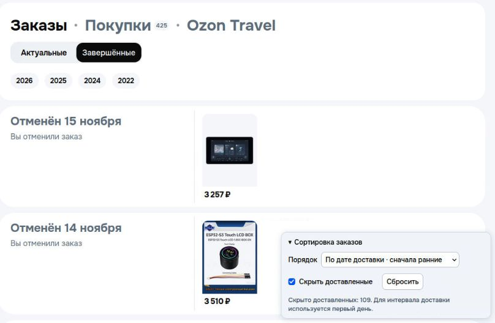

# Сортировка заказов Ozon

Скрипт Rico-X для Tampermonkey добавляет панель сортировки и фильтр на страницу **«Заказы»** в личном кабинете Ozon. Панель находится справа внизу и сворачивается нажатием на заголовок **«Сортировка заказов»**.

## Установка

1. Установите [Tampermonkey](https://www.tampermonkey.net/) для своего браузера.
2. Откройте [ozon-orders.user.js](https://raw.githubusercontent.com/rico-x/ozon-orders-tampermonkey/main/ozon-orders.user.js) и нажмите **«Установить»** или **«Обновить»** в Tampermonkey.
3. Откройте [заказы Ozon](https://www.ozon.ru/my/orderlist/) или обновите вкладку, если она уже открыта.

Для ручной установки скачайте ZIP из [последнего релиза](https://github.com/rico-x/ozon-orders-tampermonkey/releases/latest) и распакуйте его. В панели Tampermonkey создайте новый скрипт или откройте установленный **«Ozon — сортировка заказов»**. Замените содержимое редактора содержимым файла `ozon-orders.user.js` и сохраните.

## Использование

- **По дате заказа** — дата оформления из деталей заказа. Скрипт применяет сортировку после загрузки дат. Если дату получить не удалось, карточка остаётся в конце списка и появляется кнопка **«Повторить загрузку дат»**.
- **По дате доставки** — ожидаемая дата для заказов в пути и дата получения для доставленных. Для действующего интервала используется ближайший день. Если окно доставки уже началось, берётся сегодня. В пределах дня заказы с точной датой идут перед многодневными окнами, а заказы со временем сортируются по началу интервала. Истёкшие прогнозы попадают в конец списка вместе с заказами без даты.
- **Скрыть доставленные** — убирает полученные и доставленные заказы из текущего списка. Заказы, ожидающие выдачи, и отменённые остаются видимыми.
- **Сбросить** — возвращает порядок Ozon и выключает фильтр.

Во вкладке **«Актуальные»** скрипт запускает штатную подгрузку Ozon сразу при открытии страницы. После подгрузки он применяет сортировку и фильтр к полному списку. **«Завершённые»** подгружаются при прокрутке, как на Ozon. Tampermonkey сохраняет выбранный порядок и состояние фильтра. Запросы за датами оформления идут только на Ozon.

## Скриншоты

На снимках показана панель версии 1.2.0.

### Сортировка по ближайшей дате доставки

### Скрытие доставленных заказов

## Совместимость

Скрипт проверен в Firefox 159.0.1 с Tampermonkey 5.5.0 на странице заказов Ozon. Если панель не появилась, проверьте, что скрипт включён, обновите страницу и дождитесь загрузки заказов.

## Лицензия

[MIT](LICENSE) © 2026 Rico-X.
